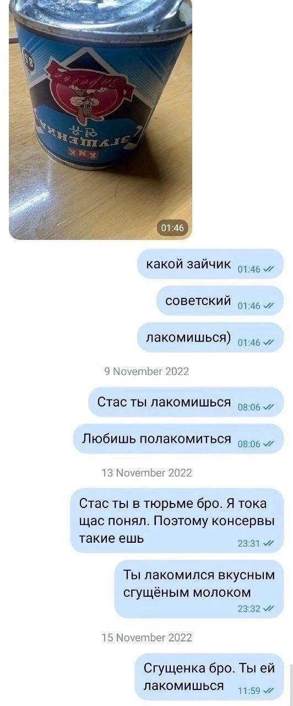

Лабораторная Работа №1.

ФИО: Якуба Антон Андреевич.
Группа: 6404-010302D.
Научный Руководитель: Гоголева С.Ю.
Тема ВКР: Поиск Алгоритма Подбора Параметра Регуляризации Для Плохо Обусловленных Задач С Помощью Нейронных Сетей.

Любимая Цитата: "Новые ЭмСи Лучше Тех, Что На Пенсии" - Yung Trappa.

Картинка, Которая Мне Нравится.

Лабораторная работа № 2

Тема: клауд-рэп.

Многостраничный сайт о клауд-рэпе: его истории, исполнителях и ключевых релизах. Сайт состоит из четырёх страниц. Создан с использованием HTML и CSS.

Страницы:
- [Главная](lab2/index.html)
- [История](lab2/history.html)
- [Артисты](lab2/artists.html)
- [Альбомы](lab2/albums.html)